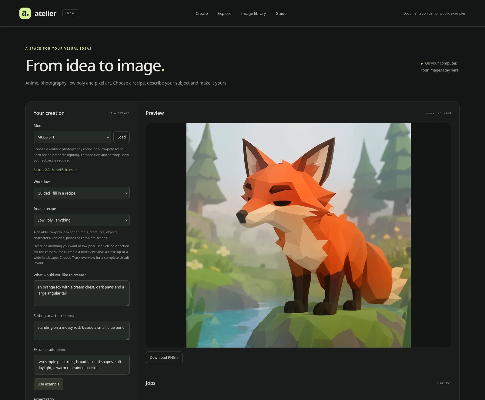
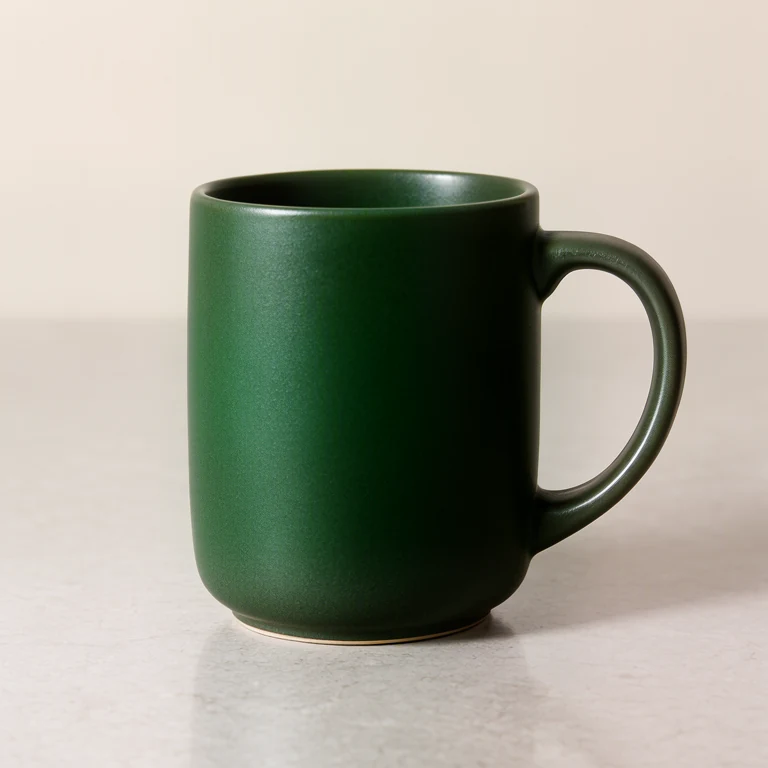
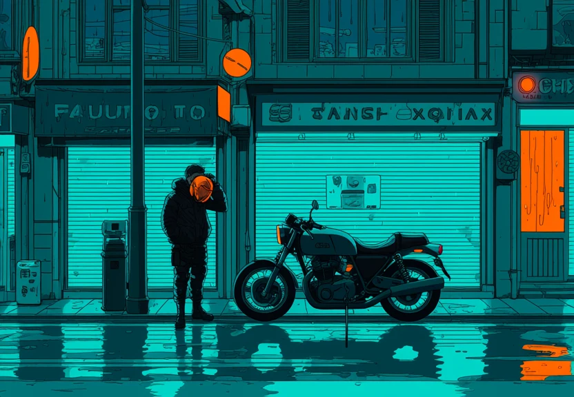
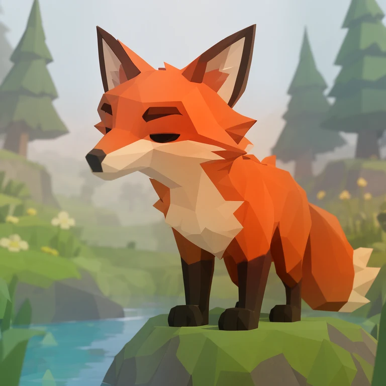
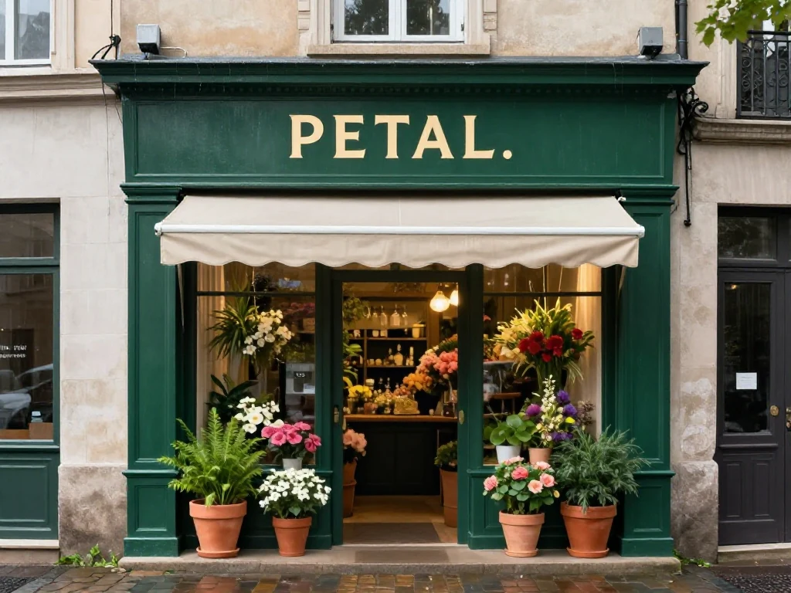
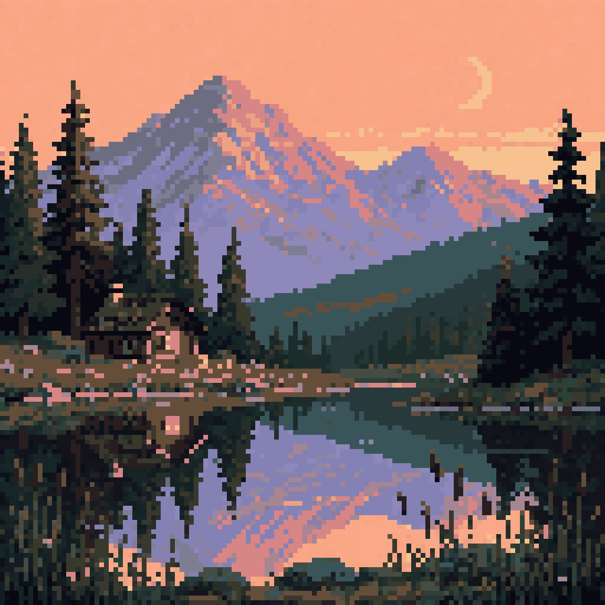
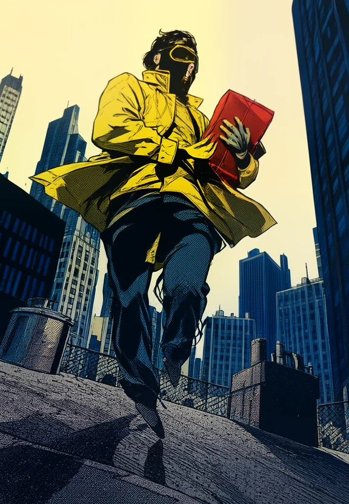
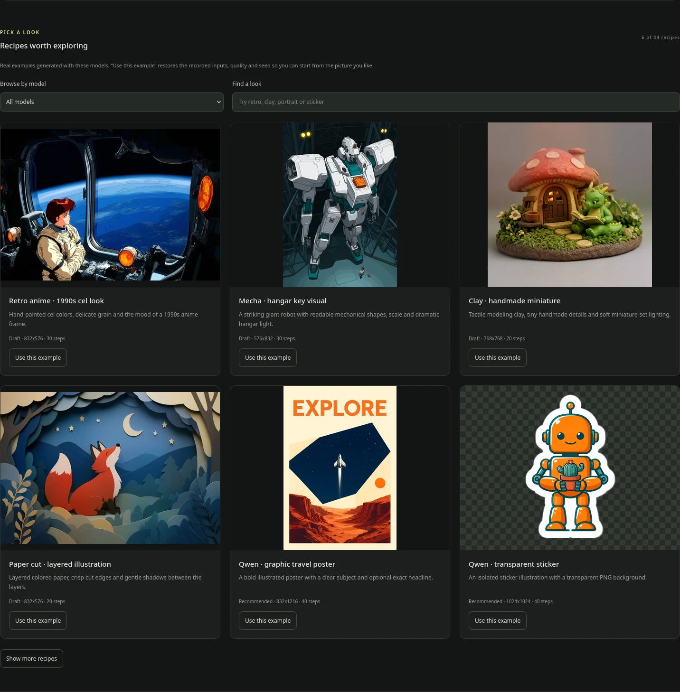

# Local Image AI Service

**Meet Atelier, your local image studio.** Pick a look, describe what you have in mind, and start creating. The same models and presets work in the browser, from the terminal, and through your coding agent.

**6 models · 82 guided presets · 7 aspect ratios · Studio, CLI and MCP**



*The Studio, shown with bundled public examples. Screenshots use a separate documentation demo.*

[Get started](#open-the-studio) · [See what you can make](#a-few-things-you-can-make) · [Browse the examples](docs/examples.md) · [Use an AI agent](docs/agents-integration.md) · [Documentation](docs/README.md)

## A few things you can make

These are actual outputs from the local service. Click a picture for its preset, settings and a command you can try yourself.

<table>
<tr>
<td align="center"><a href="docs/examples.md#photography"></a><br/><strong>Natural photography</strong><br/>MOSS · product, portrait, food and more</td>
<td align="center"><a href="docs/examples.md#anime"></a><br/><strong>Anime and illustration</strong><br/>Anima Aesthetic · characters and worlds</td>
<td align="center"><a href="docs/examples.md#low-poly"></a><br/><strong>Low-poly ideas</strong><br/>MOSS · animals, objects and entire scenes</td>
</tr>
<tr>
<td align="center"><a href="docs/examples.md#lettering"></a><br/><strong>Lettering in the image</strong><br/>Z-Image Turbo · a short sign or label</td>
<td align="center"><a href="docs/examples.md#pixel-art"></a><br/><strong>Pixel art</strong><br/>FLUX.2-klein · icons, characters and landscapes</td>
<td align="center"><a href="docs/examples.md#comics"></a><br/><strong>Bold comic art</strong><br/>MOSS · ink, halftones and strong colors</td>
</tr>
</table>

For game concepts, there are also [kart references and complete track overviews](docs/examples.md#game-concepts). The images are useful starting points for Blender; [3D Asset Views](docs/asset-views.md) renders seven matching directions from an imported GLB, including shared pixel palettes and real voxel meshes.

## Open the Studio

If the service is already installed:

```bash
local-image-ai-service studio
```

This starts the service, waits for the selected model, and opens **[Atelier in your browser](http://127.0.0.1:7861/studio/)**. The Studio and API run in the same service.

1. **Find a look.** Open **Explore** and pick an example you like.
2. **Make it yours.** Click **Use this example** and change the subject. Setting and extra details are optional.
3. **Try a draft.** Check the composition, then choose **Recommended** when you want a larger or more detailed result.

Your image and its settings stay in the library. You can download it, reuse the settings, compare two results, or delete a selection later.

**First visit?** Follow the [installation guide](docs/installation.md). The current setup needs Linux, systemd, NVIDIA CUDA and local model files. It has been tested on an RTX 5070 Laptop with 8 GB VRAM using CPU offloading; this is not a one-click installer for every GPU.

## Choose a model by what you want to make

| Model | A good place to start | Guided presets |
| --- | --- | ---: |
| **MOSS SFT** | Realistic photos, comic and craft illustrations, low-poly scenes and modeling references and voxel concepts | 34 |
| **Anima Aesthetic 1.1** | Anime portraits, manga, mecha, cozy scenes and illustrated backgrounds | 17 |
| **FLUX.2-klein · Pixel Art** | Small icons, game characters and pixel landscapes with concept sheets | 11 |
| **Z-Image** | Fantasy painting, ink wash, vintage science fiction, fashion and botanical art | 5 |
| **Z-Image Turbo** | Quick photo, cinema, product, lettering and food studies | 5 |

The [complete catalog](skills/local-image-ai/references/catalog.md) lists every preset. Guided mode chooses the matching model for you; free prompt mode gives you the sampling controls too.

Model licenses differ. In particular, **Anima's model weights are non-commercial** (generated images may be used commercially). Each model has a license link in the Studio; see [the model notes](docs/README.md#models-and-looks) before choosing it for a project.

See [Z-Image setup and the preset research notes](docs/z-image-and-presets.md) for sources, settings and the new looks.

## Explore before you write a prompt



Each example includes its original inputs, quality, seed and sampling settings. Start from a picture you like instead of guessing a long list of prompt tags. You can inspect the full composed prompt before generating anything.

[Take the Studio tour](docs/studio.md) · [Try a recipe](docs/examples.md) · [Make Low Poly with MOSS](docs/moss-lowpoly.md)

## Create from the terminal

Use `render` for the same guided workflow as the browser. It queues the image, switches models through the Studio worker, and can save the result straight into your project:

```bash
local-image-ai-service start
local-image-ai-service render --recipe lowpoly-anything \
  --subject 'an orange fox exploring a crystal cave' \
  --quality preview --seed 42 --save-dir ./artifacts
```

Discover the available choices with `models`, `recipes`, `presets` and `formats`. For long runs, use `--async`, keep the returned job ID, and come back with `jobs get`, `jobs wait` or `export`. A client timeout leaves the image job running.

[CLI walkthrough and examples →](docs/agent-cli.md)

## Let your agent do the setup

The installable **local-image-ai** skill teaches an agent to choose a preset, preview the prompt, generate locally and export the finished asset. MCP exposes the same workflow as 22 tools, including model discovery and library management.

For Codex:

```bash
local-image-ai-service agents install --mcp --route-images
```

Then try a brief such as:

> Create a low-poly orange fox beside a pond. Use the local image service and save the result in this project's assets folder.

[Set up Codex, Claude Code or OMP →](docs/agents-integration.md) · [Package the portable skill →](docs/agents-integration.md#install-the-skill-and-mcp-integration)

## Find the guide you need

| I want to… | Start here |
| --- | --- |
| Install, update or remove the service | [Installation](docs/installation.md) |
| Learn the browser workflow | [Studio tour](docs/studio.md) |
| See images and try their presets | [Example gallery](docs/examples.md) |
| Make low-poly game concepts | [MOSS Low Poly](docs/moss-lowpoly.md) |
| Render consistent Low Poly, Pixel and Voxel views | [3D Asset Views](docs/asset-views.md) |
| Prepare useful Blender references | [Blender workflow](docs/blender-references.md) |
| Use the terminal or an AI agent | [CLI](docs/agent-cli.md) · [MCP and skills](docs/agents-integration.md) |
| Connect an application | [HTTP API](docs/api.md) · [Open WebUI](docs/open-webui.md) |
| Fix a problem | [Troubleshooting](docs/troubleshooting.md) |

[All documentation, model guides and verification reports →](docs/README.md)

<details>
<summary><strong>For developers and maintainers</strong></summary>

Atelier is a static Astro frontend served by a Python HTTP adapter. A separate, pinned `stable-diffusion.cpp` process handles inference. Model weights, private configuration and the user's image archive live outside the repository. The bundled image examples are public documentation assets.

```bash
python3 -m unittest discover -s tests -v
npm run build --prefix studio
```

Python 3.11+ and Pillow 12.3+ are required. To include MCP checks, run the tests with the optional MCP environment described in the [agent integration guide](docs/agents-integration.md). Browser checks use Firefox. Explicit GPU checks have their own service lifecycle requirements; see the [verification reports](docs/README.md#verification-and-history) before running them.

[Architecture](docs/architecture.md) · [Runtime decision](docs/inspection.md) · [Pinned runtime](runtime.lock.json) · [Screenshot maintenance](docs/screenshots.md)

</details>
