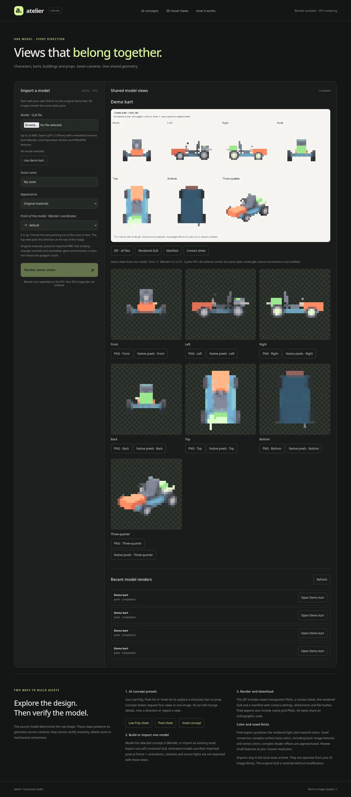

# Asset views verification — 2026-11-02

The new workflow was implemented and installed locally: **82 guided presets, 17 free styles, 82 generated public examples, 22 MCP tools**. Six AI model profiles remain configured. The existing AI image gallery remained empty; public example generation used its isolated archive.

## Automated checks

| Check | Result |
| --- | --- |
| Python + optional MCP SDK | 131 tests, successful run; one existing optional NumPy-dependent check skipped |
| Existing recipe compatibility | All 1,680 example × quality × format requests for the original 70 recipes match the prior commit's prompts/settings |
| Astro | Static production build passed, including `/studio/asset-views/` |
| Firefox | 10 tests passed: existing recipe/example flows plus real CPU import, all seven views, downloads, keyboard activation, reload recovery, square frame dimensions and 390px layout |
| Semgrep | 219 rules, 34 source/script targets, zero open findings |
| Installed service | Ready with MOSS; live catalog has 6 models, 82 recipes, 17 styles and 82 examples |
| Installed stdio MCP | All 22 tools discovered; real voxel import, status polling and ZIP export completed |

Semgrep's subprocess taint rule flagged the native verifier's fixture output path. This was reviewed: execution uses a fixed argument list without a shell, a trusted generated fixture script, and an output filename following Blender's `--` delimiter. The line has a documented suppression for that false positive. Runtime upload/render paths have no suppressed security findings.

Browser verification used the documentation server with explicit `--allow-asset-renders`; AI generation remains disabled there. Tests that submit AI jobs or mutate the historical image library were outside this browser run. Import/authentication/cancellation/CLI timeout tests also run against the real HTTP adapter in isolated temporary directories. This is focused UI/accessibility verification, not a formal WCAG audit or manual screen-reader certification.

## Native geometry and export checks

`scripts/verify-asset-views.py` completed six imports with Blender **5.2.2 LTS**. Cycles used CPU, 32 samples, denoising and four render threads. All used the same public asymmetric kart, except the final texture/color fixture.

| Case | Time | Verified |
| --- | ---: | --- |
| Original PBR | 29.07 s | Seven visible orthographic views, one camera scale, static model, ZIP hashes |
| Flat shading | 28.44 s | Same camera/geometry contract with matte flat appearance |
| Pixel, 64², 24 colors | 2.20 s | Shared palette across all directions, binary alpha, native and 512² PNGs |
| Voxel, longest grid 24 | 28.45 s | One actual derived cube surface mesh, shared by all seven views |
| Pixel, front +Y, 32² | 2.19 s | Reversed front camera matches the original back position; top orientation follows the selected front |
| Textured + vertex-colored fixture | 26.00 s | Red/green embedded image texels and blue `COLOR_0` survive voxel conversion; no material warnings |

All rendered GLBs passed the embedded GLB validator. All camera projections are `ORTHO`; each job has one common `ortho_scale`. Source hashes and every archived output hash were checked. The native checker also inspected all PNG alpha bounds and ZIP CRCs.

The installed systemd service then completed a separate MCP voxel render in **28.56 s**, with **2,079 occupied cells and six material colors**. Its ten-file ZIP exported through MCP exactly matches the API download bytes. This also exercised the installed Blender executable, protected service filesystem, private job cache/config paths and CPU process settings. One completed **Demo kart · Voxel Art** render remains available in the asset archive as a useful example. No private character/world files were published or modified.

## New AI examples and visual review

All twelve new examples were generated by the actual local model pipeline, seed 42. Original input fields, full prompts, sizes, sampling settings and output provenance are recorded in the [public manifest](../studio/public/recipe-examples/manifest.json).

| Preset | Canvas | Steps | Time |
| --- | --- | ---: | ---: |
| lowpoly-character-sheet | 768² | 30 | 59.46 s |
| lowpoly-kart-sheet | 768² | 30 | 56.42 s |
| lowpoly-prop-sheet | 768² | 30 | 55.97 s |
| voxel-character | 576×832 | 30 | 44.45 s |
| voxel-kart | 832×576 | 30 | 44.49 s |
| voxel-prop | 768² | 30 | 57.20 s |
| voxel-building | 768² | 30 | 57.71 s |
| voxel-diorama | 832×576 | 30 | 44.92 s |
| voxel-anything | 768² | 20 | 38.84 s |
| pixel-character-sheet | 1024² → 128² | 8 | 38.91 s |
| pixel-kart-sheet | 1024² → 128² | 8 | 34.33 s |
| pixel-prop-sheet | 1024² → 128² | 8 | 34.17 s |

Visual review confirms readable proposed character/kart/prop directions and cubic voxel subjects. The MOSS character sheet separates front, profile, back and three-quarter; the kart sheet includes a top proposal. These are useful concepts, with unresolved differences: chest examples round the requested flat lid, small costume/mechanical details vary, and the pixel kart's requested top panel remains oblique. Pixel subjects use coarse clusters inside the 128² sheet. None of these AI images is presented as geometric QA. For exact cross-view geometry, use the GLB workflow and review the source model itself.

The GPU briefly became unavailable due to unrelated Blender/image work. Those processes were left running. An initial MOSS attempt failed during text encoding under competing GPU memory use; its failed record remains in the isolated example archive. Three pixel examples later waited until the GPU was free. Load refusals occurred before submission and did not duplicate completed images. The final service is running, with no pending image jobs.

## Private client skill refresh

The managed `local-image-ai` skill was subsequently updated in the shared private
frontend-ai-stack catalog and in its source `payload/private/skills` directory.
Claude Code and OMP were synchronized with `mm-profile-skills-sync`. Every skill
file and receipt hash matches the current service package and Codex copy, including
the generated 82-preset inventory and GLB/pixel/voxel workflow reference.

`claude mcp get local-image-ai` reports connected. A real stdio discovery call
through OMP's configured launcher found 22 tools and 82 presets. The stack's
`verify-profiles.sh` passed before and after the refresh; the strict all-client,
both-profile skill audit reports zero problems. The shared project-memory doctor
also passed for Working and Private. Skill directory/link snapshots confirm that
the refresh preserved other skills and the Working profile boundaries. Existing
client sessions need a fresh session to load updated skill/MCP discovery.
