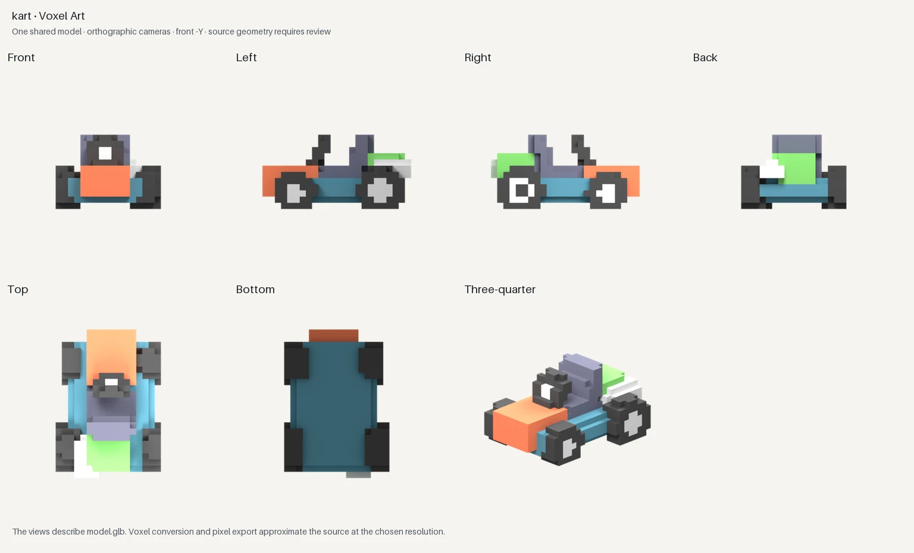

# Asset concepts and consistent model views

[Open 3D Asset Views](http://127.0.0.1:7861/studio/asset-views/) · [All presets](../skills/local-image-ai/references/catalog.md)

Atelier now offers two connected workflows. AI presets propose a design; the GLB renderer creates matching views of an existing model. Importing a picture does not reconstruct its hidden geometry.

## Explore a design with AI

| Presets | Model | Result |
| --- | --- | --- |
| `lowpoly-character-sheet`, `lowpoly-kart-sheet`, `lowpoly-prop-sheet` | MOSS | A requested four-view concept sheet |
| `pixel-character-sheet`, `pixel-kart-sheet`, `pixel-prop-sheet` | Krea Pixel Art | A proposed sheet, 128-pixel grid and shared image palette |
| `voxel-character`, `voxel-kart`, `voxel-prop`, `voxel-building`, `voxel-diorama`, `voxel-anything` | MOSS | Cubic voxel-style image concepts |

Asset controls also work with the original MOSS character/vehicle/prop/building/scene references and Krea character, vehicle, loot and isometric recipes. Choose a single direction or **Concept sheet**. The latter requests front, left profile, back and either top or three-quarter in a 2×2 arrangement. Directions, number of panels and repeated details remain estimates. A seed, requested orthographic camera or polished sheet does not certify shared geometry.

## Render one model from seven directions

1. Build the chosen design in Blender, or use an existing model. Select the intended asset and export **glTF 2.0 → GLB** with embedded PNG/JPEG textures and uncompressed meshes.
2. Open **3D Asset Views**, choose the GLB and the axis pointing out of its nose or face. Coordinates refer to Blender after import: **Z up**, front defaults to **−Y**. Use **Demo kart** to try an original public test asset.
3. Choose original materials, Low Poly flat shading, Pixel Art or Voxel Art. Render once and download the ZIP.

The seven directions are front, left, right, back, top, bottom and three-quarter. All use the same centered static geometry, camera target and orthographic scale, with a 16% framing margin. The top view places the selected front direction at the top. Left means the object's left: with front −Y, the left camera is at +X and the nose points left in that profile. There is no perspective convergence. Square PNG dimensions and shared scale are preserved in the UI and downloads.

The importer evaluates visible meshes in the imported pose at frame 1, bakes their transforms and centers the result on the ground. It preserves relative part placement and source scale. Source cameras, lights, animations and rigs are omitted from the static rendered GLB. Source dimensions are recorded in glTF meters; a wrongly exported source scale stays wrong.

| Appearance | What changes |
| --- | --- |
| Original materials | Imported glTF PBR under neutral studio lights |
| Low Poly | Flat face normals, matte non-emissive shading; no polygon reduction or remeshing |
| Pixel Art | Render directly on a 32, 64 or 128 grid; quantize all seven images with one palette, binary alpha and no dithering; enlarge with nearest-neighbor to 512² |
| Voxel Art | Sample surface cells on one cubic grid, remove internal neighbor faces, assign a shared material palette, then render that same derived cube mesh from all seven cameras |

Voxel conversion approximates the surface rather than filling a solid volume. Thin features, gaps and silhouettes can change. Surface colors use nearest samples of basic UV image textures, vertex colors and base materials. Procedural effects, transformed UVs, transparency and complex shaders can be approximated or lost; detected unsupported color nodes produce manifest warnings. Pixel palette reduction also approximates the source lighting/colors. Neither process repairs an incorrect source model.



The ZIP contains `model.glb`, `sheet.png`, seven transparent 512² PNGs, `asset-views.json` and, for Pixel Art, seven `*.native.png` files. The manifest records source/rendered hashes, camera positions/quaternions, common scale, bounds, renderer, appearance, voxel settings, warnings and a hash for each output file. Contact sheets label actual directions and describe the source review requirement; they do not display invented QA PASS badges. Edge-on flat geometry can legitimately leave an empty projection, which is recorded.

## CLI and MCP

```bash
local-image-ai-service assets options
local-image-ai-service assets render --input ./kart.glb --name "My kart" \
  --style pixel --front=-Y --pixel-grid 64 --colors 24 --async
local-image-ai-service assets get JOB_ID
local-image-ai-service assets wait JOB_ID --timeout 30
local-image-ai-service assets export JOB_ID --save-dir ./artifacts

local-image-ai-service assets render --input ./kart.glb \
  --style voxel --voxel-grid 24 --save-dir ./artifacts
```

`--front=-Y` uses an equals sign so argument parsing treats the negative axis as a value. The default synchronous client wait is 330 seconds; a timeout retains the accepted ID and does not cancel or resubmit. `assets list` recovers recent jobs and `assets cancel JOB_ID` cancels only that job. Export writes a new ZIP without extracting paths or overwriting earlier exports.

MCP exposes `list_asset_views`, `render_asset_views`, `get_asset_views`, `export_asset_views` and `cancel_asset_views`. Submission returns immediately. Poll the accepted ID, then export; do not submit again because a client disconnected. The existing image tools also accept the new recipes and `modeling_view: "sheet"`, `"right"` or `"bottom"`.

## Installation, API and boundaries

Blender is an optional local dependency for this route. The executable is resolved from `PATH`, falling back to `~/.local/bin/blender`. Tested with Blender **5.2.2 LTS**, Cycles CPU, 32 samples and CPU denoising. The main AI service still requires its configured CUDA runtime. Imports run as separate background Blender processes with factory startup, auto-execution disabled, offline mode and no visible CUDA device. They do not open the user's Blender session or change its files. Caches/config stay inside the job directory.

The authenticated Studio API provides `GET /studio/api/assets/options`, `GET/POST /studio/api/assets`, `GET /studio/api/assets/{id}`, `POST …/{id}/cancel` and `GET …/{id}/files/{name}`. Upload JSON contains base64 `data` and optional `name`, `style`, `front`, `pixel_grid`, `colors`, `voxel_grid`. Only known settings and whitelisted output names are accepted. This route's JSON limit is 45 MiB; the existing image API limits are unchanged.

Only embedded binary glTF 2 files up to 32 MiB are accepted. External/data URIs, compressed Draco/meshopt requirements and non-PNG/JPEG textures are rejected. Limits include one million vertices including instances, 1024 primitives, 4096 nodes, 32 million accessor components, 4096-pixel texture edges and 64 million total texture pixels. Header/chunk/buffer/accessor bounds and node hierarchies are checked before Blender. Rendering is serial, with three pending slots and a five-minute process deadline. Output data is capped at 100 MiB before packaging. A service restart marks interrupted renders failed rather than silently submitting them again.

Imports and outputs live in the private local Studio asset archive, separate from the AI image library. The original GLB remains unmodified. API authentication applies to uploads, status and every download. Browser keys stay in tab memory; session storage retains only the last accepted job ID. Lost submission responses show a recovery instruction rather than retrying automatically.

## Verification

Run `python3 scripts/verify-asset-views.py --output /tmp/atelier-asset-check`. This exercises all four styles, all seven cameras, a reversed front axis, texture/vertex-color conversion, shared pixel palettes, GLB re-import validation and ZIP file hashes. It uses an original asymmetric demo kart and generated color fixtures; private project assets are not published. Unit tests cover import rejection, authentication, cancellation, CLI timeout recovery and palette/archive integrity. Firefox tests cover the real CPU import, downloads, reload recovery, keyboard activation, undistorted image dimensions and mobile layout.

The workflow is based on Blender's [orthographic cameras](https://docs.blender.org/manual/en/latest/render/cameras.html) and [glTF import/export](https://docs.blender.org/manual/en/latest/addons/import_export/scene_gltf2.html), and the [Khronos glTF 2.0 container specification](https://registry.khronos.org/glTF/specs/2.0/glTF-2.0.html). The implementation deliberately supports a smaller embedded subset of glTF.

Results, measured timings and visual limitations are recorded in the [verification report](asset-views-test-report.md).
