# A few ideas to get you started

Every image on this page was generated by the local service. These are the same public examples you can inspect in **Explore** inside the Studio. No private gallery images are included.

Pick a look, choose **Use this example**, and change the subject first. You can keep the recorded seed while you try different details. The commands below reproduce the recorded requests; exact pixels can vary with hardware, runtime or weights.

[Open the Studio](http://127.0.0.1:7861/studio/#explore) · [Studio tour](studio.md) · [All 82 presets](../skills/local-image-ai/references/catalog.md)

## Photography

**A quiet product photograph.** The green mug is a simple place to start: one object, one surface and soft light. Replace it with your own product before adding a more elaborate setting.

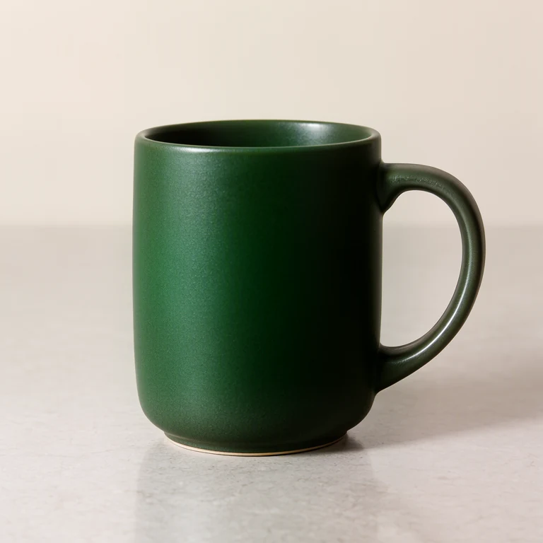

**Preset:** `photo-product` · **Model:** `moss` · **Quality:** Draft · **Canvas:** 768 × 768

<details>
<summary>Try this example from the terminal</summary>

With the service running, save these inputs as `example.json`:

```json
{
  "recipe": "photo-product",
  "subject": "a matte forest-green ceramic coffee mug with a curved handle",
  "scene": "on a pale stone tabletop against a warm off-white background",
  "details": "subtle glaze texture, a small rounded foot, soft shadow to the right",
  "quality": "preview",
  "seed": 42
}
```

```bash
local-image-ai-service render --input example.json --save-dir ./artifacts
```

Recorded settings: 30 euler steps, CFG 3.0, seed 42. The published WebP may be smaller than the generation canvas.

</details>

## Anime

**A neon-lit character scene.** Anima handles the character and background together. Describe the clothing, pose and one important light source; a short clear scene is easier to steer than a list of competing styles.

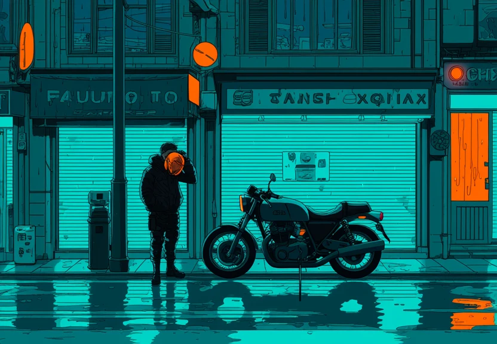

**Preset:** `anima-neon` · **Model:** `anima` · **Quality:** Recommended · **Canvas:** 1216 × 832

<details>
<summary>Try this example from the terminal</summary>

With the service running, save these inputs as `example.json`:

```json
{
  "recipe": "anima-neon",
  "subject": "an adult motorcycle courier with a black jacket and an orange helmet under one arm",
  "scene": "waiting beside a motorcycle on a rainy city street at night",
  "details": "cyan shop windows, orange streetlights, reflected neon",
  "quality": "standard",
  "seed": 42
}
```

```bash
local-image-ai-service render --input example.json --save-dir ./artifacts
```

Recorded settings: 35 euler steps, CFG 4.5, seed 42. The published WebP may be smaller than the generation canvas.

</details>

## Low Poly

**An idea with a clear low-poly look.** Anything is the flexible preset for animals, objects and whole scenes. Here, a fox and pond give the image one clear subject and a simple setting.

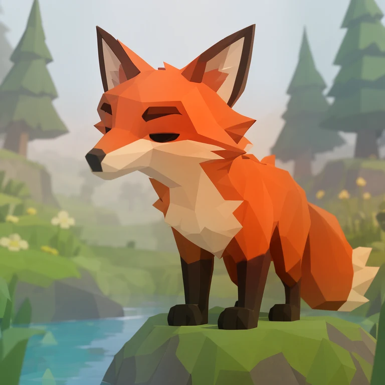

**Preset:** `lowpoly-anything` · **Model:** `moss` · **Quality:** Draft · **Canvas:** 768 × 768

<details>
<summary>Try this example from the terminal</summary>

With the service running, save these inputs as `example.json`:

```json
{
  "recipe": "lowpoly-anything",
  "subject": "an orange fox with a cream chest, dark paws and a large angular tail",
  "scene": "standing on a mossy rock beside a small blue pond",
  "details": "two simple pine trees, broad faceted shapes, soft daylight, a warm restrained palette",
  "quality": "preview",
  "seed": 42
}
```

```bash
local-image-ai-service render --input example.json --save-dir ./artifacts
```

Recorded settings: 30 euler steps, CFG 3.0, seed 42. The published WebP may be smaller than the generation canvas.

</details>

## Lettering

**A short sign in the image.** The Visible text field contains PETAL for this example. Change it to a short phrase and check the result: lettering can still contain mistakes.

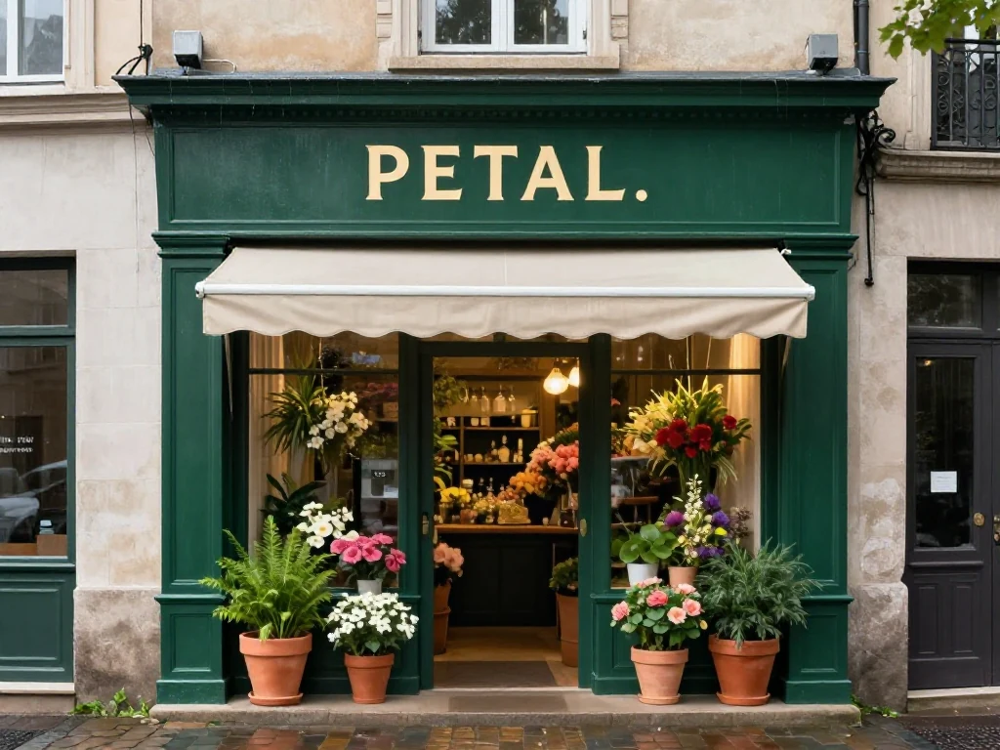

**Preset:** `zimage-turbo-sign` · **Model:** `z-image-turbo` · **Quality:** Recommended · **Canvas:** 1024 × 768

<details>
<summary>Try this example from the terminal</summary>

With the service running, save these inputs as `example.json`:

```json
{
  "recipe": "zimage-turbo-sign",
  "subject": "a tiny corner flower shop with one dark green painted sign",
  "scene": "on a quiet cobbled street after light rain",
  "details": "terracotta pots, cream awning, warm light through the doorway",
  "text": "PETAL",
  "quality": "standard",
  "seed": 42
}
```

```bash
local-image-ai-service render --input example.json --save-dir ./artifacts
```

Recorded settings: 8 euler steps, CFG 1.0, seed 42. The published WebP may be smaller than the generation canvas.

</details>

## Pixel Art

**A scenic world with the PXART4 LoRA.** The LoRA produces a clean pixel grid directly at 1024 square.

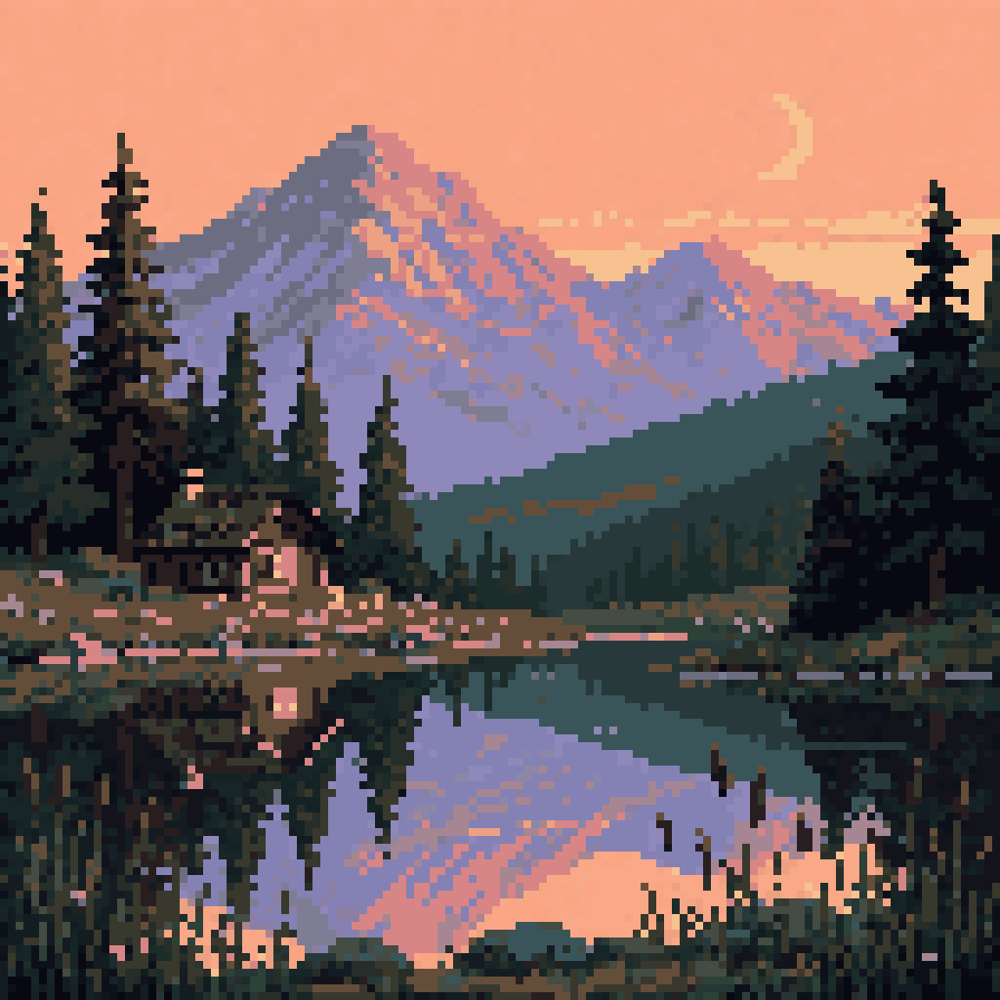

**Preset:** `pixel-landscape` · **Model:** `flux-pixel` · **Quality:** Recommended · **Canvas:** 1024 × 1024

<details>
<summary>Try this example from the terminal</summary>

With the service running, save these inputs as `example.json`:

```json
{
  "recipe": "pixel-landscape",
  "subject": "a quiet mountain lake with a small wooden cabin and tall pine trees",
  "scene": "at sunset beneath lavender mountains and a peach-colored sky",
  "details": "a warm window reflected in the water, reeds in the foreground, a thin crescent moon",
  "quality": "standard",
  "seed": 42
}
```

```bash
local-image-ai-service render --input example.json --save-dir ./artifacts
```

Recorded settings: 20 euler steps, CFG 4.0, seed 42. The published WebP may be smaller than the generation canvas.

</details>

## Comics

**One strong comic frame.** MOSS supplies bold ink contours and halftone shading. Give the frame one main action; this preset does not create a sequenced comic page or a consistent cast across panels.

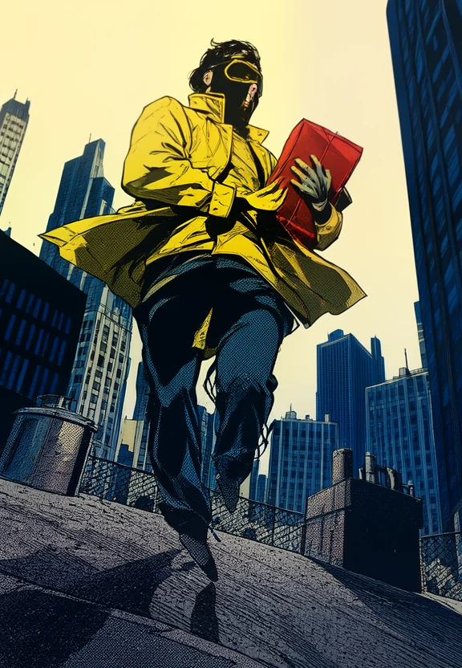

**Preset:** `moss-comic` · **Model:** `moss` · **Quality:** Draft · **Canvas:** 576 × 832

<details>
<summary>Try this example from the terminal</summary>

With the service running, save these inputs as `example.json`:

```json
{
  "recipe": "moss-comic",
  "subject": "an adult masked courier in a yellow jacket holding a red parcel",
  "scene": "on a city rooftop in strong afternoon light",
  "details": "wind in the jacket, deep navy shadows, a dramatic low angle",
  "quality": "preview",
  "seed": 42
}
```

```bash
local-image-ai-service render --input example.json --save-dir ./artifacts
```

Recorded settings: 20 euler steps, CFG 3.0, seed 42. The published WebP may be smaller than the generation canvas.

</details>

## Game concepts

**An overview of a whole circuit.** Use this as a route and scenery concept. Inspect the corners and road connections, then build a deliberate drivable spline in Blender. This example produced a rounded rectangle rather than the requested kidney-shaped route.

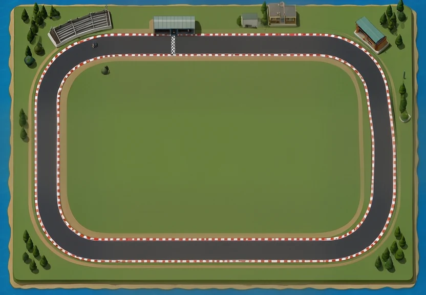

**Preset:** `lowpoly-track-overview` · **Model:** `moss` · **Quality:** Draft · **Canvas:** 832 × 576

<details>
<summary>Try this example from the terminal</summary>

With the service running, save these inputs as `example.json`:

```json
{
  "recipe": "lowpoly-track-overview",
  "subject": "a compact coastal kart circuit with one closed kidney-shaped asphalt loop, a small pit garage and two grandstands",
  "scene": "seen from directly above, with the entire circuit centered on one rectangular terrain tile",
  "details": "a consistent-width dark gray track, red and white curbs, one short checkered start-finish stripe, sparse pine trees and blue water beyond the tile",
  "quality": "preview",
  "seed": 42
}
```

```bash
local-image-ai-service render --input example.json --save-dir ./artifacts
```

Recorded settings: 30 euler steps, CFG 3.0, seed 42. The published WebP may be smaller than the generation canvas.

</details>

## Blender reference

**A kart you can block out.** Simple panels, exposed wheels and a plain background make the main volumes easier to read. Hidden connections still need modeling decisions. Use one Blender blockout for matching front, side, back and top renders.

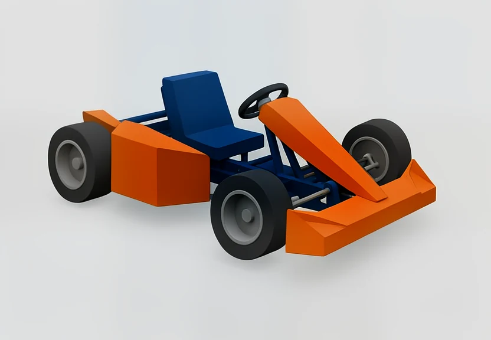

**Preset:** `lowpoly-vehicle` · **Model:** `moss` · **Quality:** Draft · **Canvas:** 832 × 576

<details>
<summary>Try this example from the terminal</summary>

With the service running, save these inputs as `example.json`:

```json
{
  "recipe": "lowpoly-vehicle",
  "subject": "a compact low-poly racing kart with four exposed black tires, one seat and a simple tubular chassis",
  "scene": "short front bumper, two axles, centered seat and steering wheel, no driver",
  "details": "matte orange body panels, dark blue seat and frame, gray wheel hubs; large solid color regions",
  "modeling_view": "three-quarter",
  "modeling_asset": "vehicle",
  "quality": "preview",
  "seed": 42
}
```

```bash
local-image-ai-service render --input example.json --save-dir ./artifacts
```

Recorded settings: 30 euler steps, CFG 3.0, seed 42. The published WebP may be smaller than the generation canvas.

</details>

## More materials, worlds and game ideas

The expanded catalog adds 26 guided looks. A few starting points:

<table>
<tr>
<td align="center"><a href="http://127.0.0.1:7861/studio/?recipe=moss-embroidery#workspace">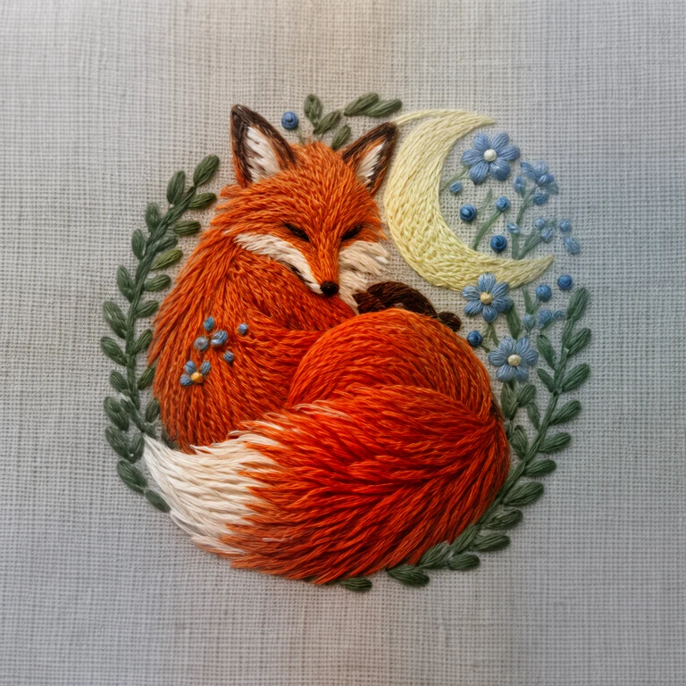</a><br/><strong>MOSS · embroidery</strong><br/>Raised threads and woven fabric</td>
<td align="center"><a href="http://127.0.0.1:7861/studio/?recipe=anima-woodblock#workspace">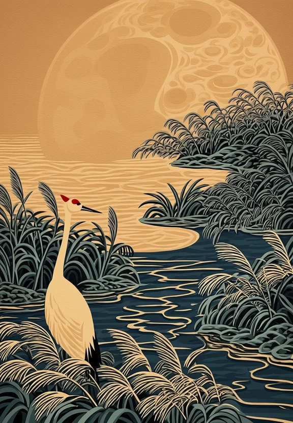</a><br/><strong>Anima · woodblock</strong><br/>Carved contours and flat pigments</td>
<td align="center"><a href="http://127.0.0.1:7861/studio/?recipe=zimage-fantasy#workspace">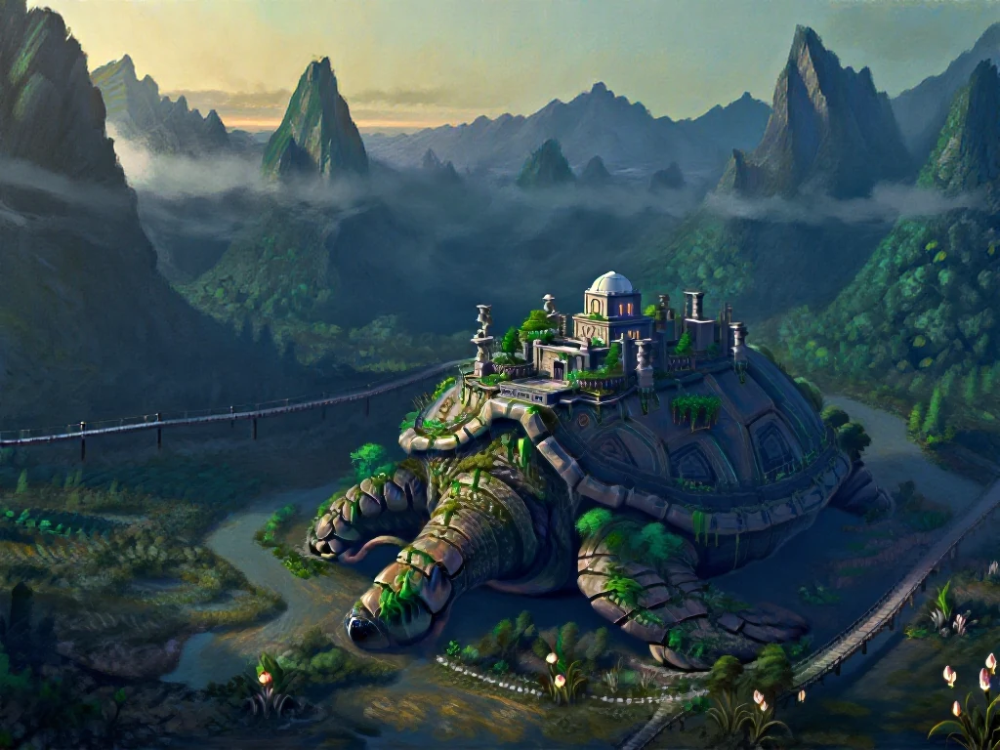</a><br/><strong>Z-Image · painted worlds</strong><br/>One impossible idea with a sense of scale</td>
</tr>
<tr>
<td align="center"><a href="http://127.0.0.1:7861/studio/?recipe=zimage-retro-scifi#workspace">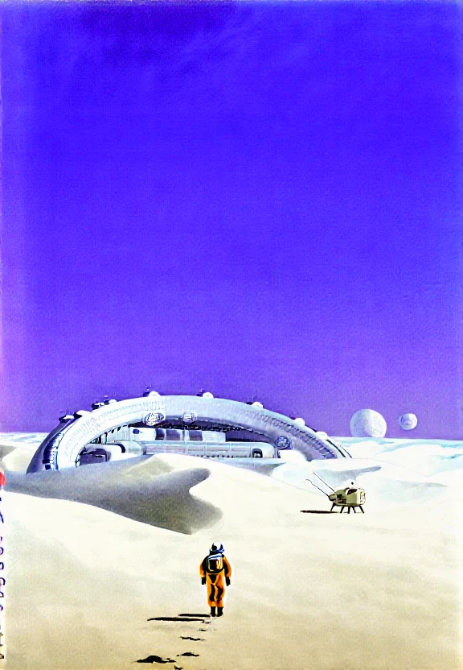</a><br/><strong>Z-Image · retro science fiction</strong><br/>Airbrushed planets and vintage machinery</td>
<td align="center"><a href="http://127.0.0.1:7861/studio/?recipe=pixel-creature#workspace">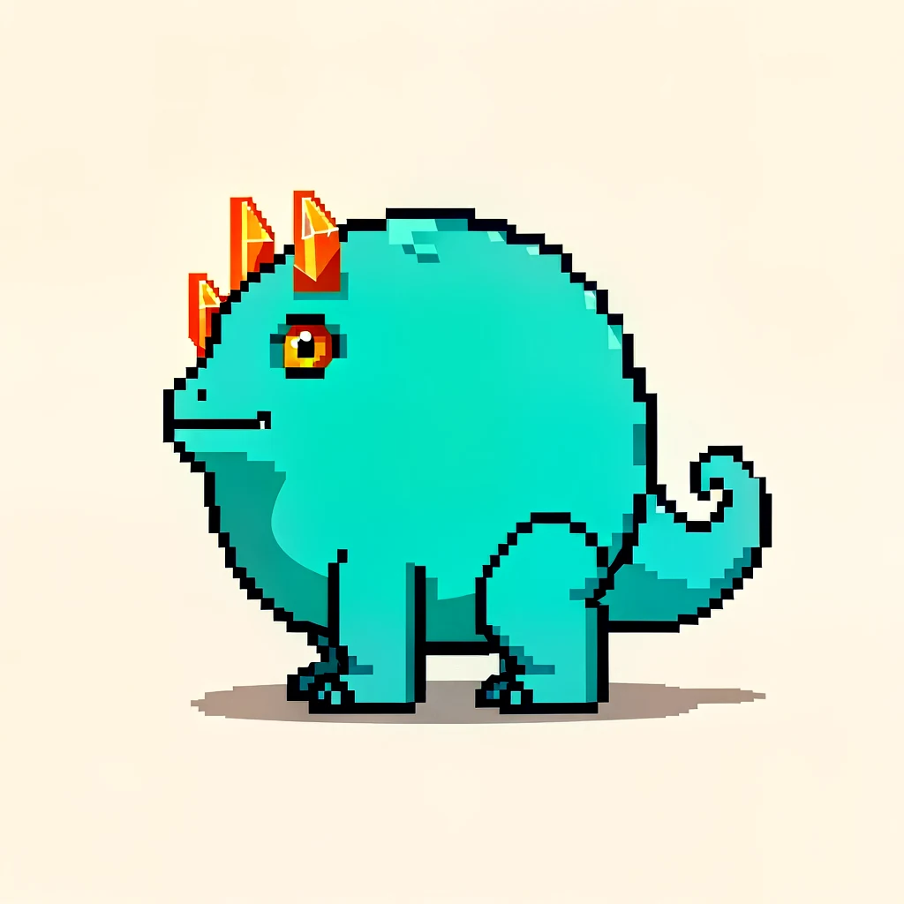</a><br/><strong>FLUX.2-klein · creature sprite</strong><br/>A small silhouette with a clean pixel grid</td>
<td align="center"><a href="http://127.0.0.1:7861/studio/?recipe=zimage-turbo-product#workspace">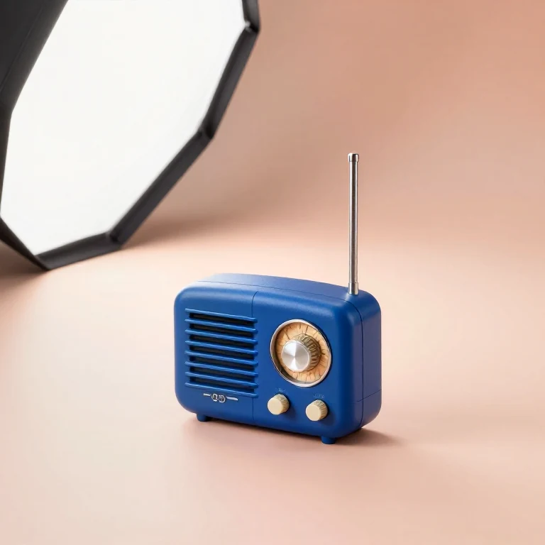</a><br/><strong>Z-Image Turbo · product study</strong><br/>Eight steps for material and color ideas</td>
</tr>
</table>

Click a picture to open its preset in the local Studio. The [research and GPU
verification notes](z-image-and-presets.md) explain the model settings and the
additional styles. As with the earlier looks, check the actual result before
using it: wording, anatomy and connected parts can vary between generations.

## Take the next step

For more natural photos, see [the MOSS photography guide](moss-photography.md). For character art, try the other Anima examples in the Studio. For modeling references, follow [the Blender workflow](blender-references.md) before asking for several matching views.

The source settings for all 82 public examples are in [the example manifest](../studio/public/recipe-examples/manifest.json). They include the original fields, composed prompt, negative prompt, seed and sampling settings.

