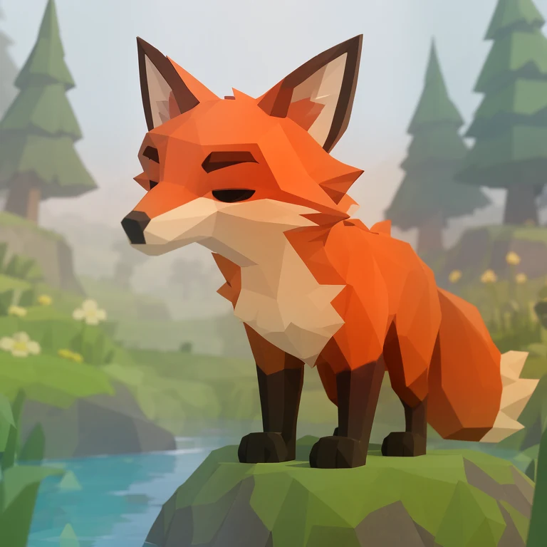
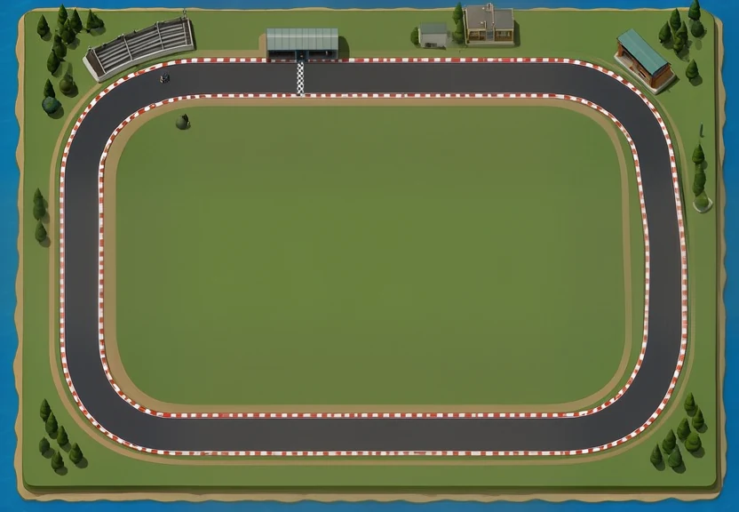
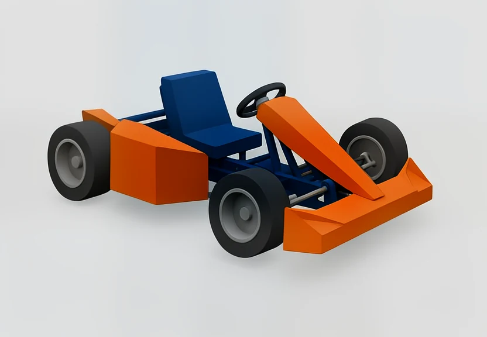

# Turn an idea into a low-poly concept

Start with **Low Poly · anything** when you have a subject in mind and want a faceted, flat-shaded look. It works for a fox, a robot, a little shop or an entire scene. Choose a more specific preset when the camera or construction matters.



*Low Poly · anything · MOSS · Draft · 768 × 768 · seed 42. [Try this example](examples.md#low-poly).*

[Open the Studio guide](http://127.0.0.1:7861/studio/lowpoly-guide/) · [All examples](examples.md) · [Blender workflow](blender-references.md)

## Pick the right starting point

| You want to make… | Choose… | Recipe ID |
| --- | --- | --- |
| An animal, creature, object or miscellaneous idea | **Anything** | `lowpoly-anything` |
| The whole layout of a racing circuit | **Track overview** | `lowpoly-track-overview` |
| One full-body character with simple clothing | **Character reference** | `lowpoly-character` |
| A complete kart or vehicle with readable main parts | **Kart and vehicle reference** | `lowpoly-vehicle` |
| One isolated object with visible thickness and joins | **Prop reference** | `lowpoly-prop` |
| A building with clear roof, walls and openings | **Building reference** | `lowpoly-building` |
| A small scene on a floating base | **Floating diorama** | `lowpoly-diorama` |
| An early-3D game look | **1990s game scene** | `lowpoly-retro` |
| A wide faceted landscape | **Landscape and game world** | `lowpoly-world` |

These are MOSS presets with visible prompts, rather than separate low-poly models or hidden adapters. Anima Aesthetic remains available for anime and illustration.

## Describe the parts you care about

Only the subject is required. For a stronger first result, give it a few concrete details:

> A small wooden chest with a flat lid, two thick iron bands and one square brass latch.

That gives the model something more useful than “a very cool, high-quality chest.” Add the setting or camera when it matters, then use extra details for the palette, proportions or important connections.

For a vehicle, mention wheel count, seating and body panels. For a character, describe the clothing masses and pose. For a building, start with its footprint, roof and openings before adding decoration.

## A whole track, or one modeling reference?

| Track overview | Kart reference |
| --- | --- |
|  |  |
| Use it to explore route shape, scenery and where the main structures belong. | Use it to read the main forms, part connections and material colors. |

**Track overview** asks for a complete route from above. Check the actual result: the published example produced a rounded rectangle, even though its brief requested a kidney-shaped circuit. Treat it as a concept and build a deliberate drivable spline in Blender.

For a character, kart, prop or building, the **Blender reference** controls prepare a single view with simple materials and neutral light. Start with three-quarter to understand the volumes. Independent front/side/back images can change the design; they are not automatically matching blueprints.

For consistent views, approve one concept, build a simple Blender blockout, and render the views from that shared geometry. [The Blender guide](blender-references.md) explains that handoff.

## Try a draft before a longer run

MOSS Recommended uses **50 Euler steps, CFG 3 and flow shift 5**. Anything, Track overview and Blender-reference Drafts use 30 steps at smaller dimensions. The original scene Drafts use 20. More detail uses 60.

Start with Draft to check framing and silhouette. Keep the seed fixed and adjust one field at a time. Once the idea reads well, try Recommended for the larger final canvas. A longer run cannot guarantee that a missing wheel or wrong camera angle will fix itself.

## Use the same presets from the terminal

```bash
local-image-ai-service recipes --model moss --search lowpoly

local-image-ai-service render --recipe lowpoly-anything \
  --subject 'a fox exploring a crystal cave' \
  --quality preview --seed 42 --save-dir ./artifacts

local-image-ai-service render --recipe lowpoly-track-overview \
  --example --quality preview --seed 42 --save-dir ./artifacts/track
```

For an explicit character reference:

```bash
local-image-ai-service render --recipe lowpoly-character \
  --subject 'an adult courier with a green jacket and brown boots' \
  --modeling-view front --modeling-asset character \
  --seed 42 --save-dir ./artifacts/character
```

Use `compose` in place of `render` to preview the prompt without generating. An agent can choose and run the same presets through [MCP or the portable skill](agents-integration.md).

## Earlier Anima low-poly profiles

The separate Anima PS1/PSX and Low Poly Style profiles have been retired. Their historical images remain viewable and exportable. Shared Anima base components and original downloaded source files are retained.

See [the migration and rendering report](moss-lowpoly-test-report.md) for measured times, visual limitations and preservation checks.
