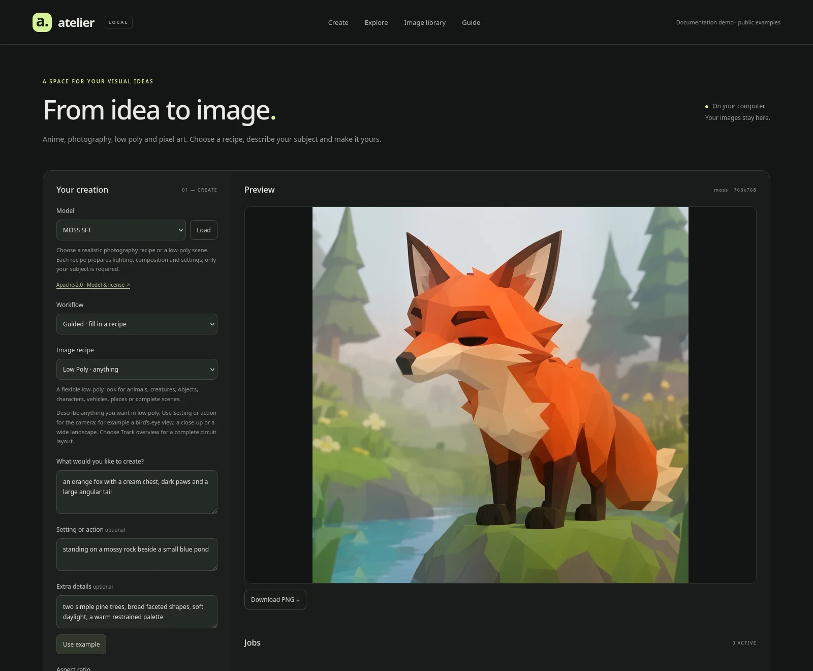
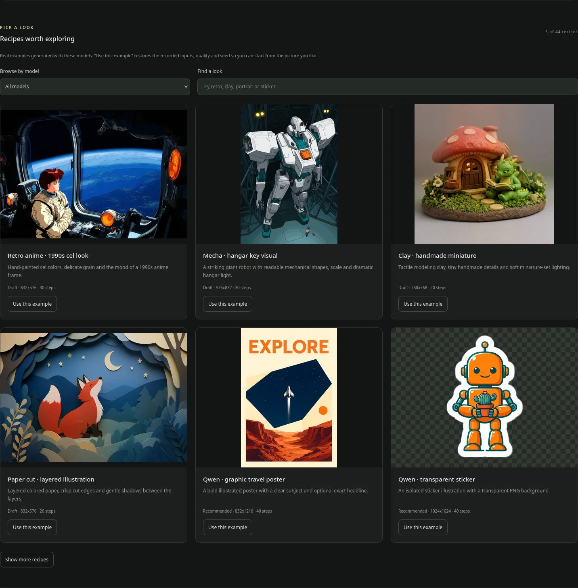
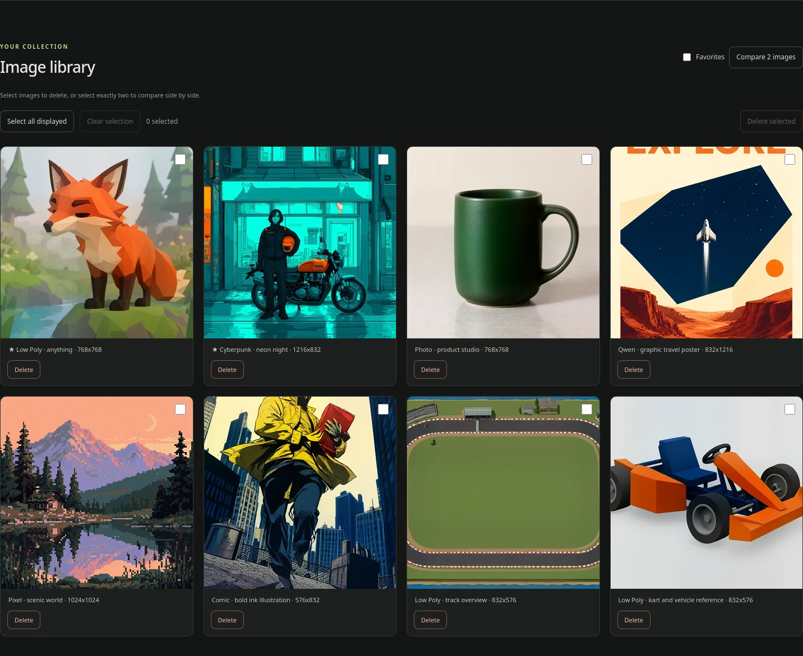

# Your first image in Atelier

You do not need to know the right sampler or assemble a page of prompt tags. Start with a picture you like, change the subject, and see what happens.

```bash
local-image-ai-service studio
```

The command starts the service and opens [the Studio](http://127.0.0.1:7861/studio/). If it is your first setup, follow [the installation guide](installation.md) first.



*Screenshots show the real interface with bundled public examples in an isolated documentation demo.*

The header of **Your creation** switches the panel between **Easy** and **Expert**. Easy hides the workflow choice, the model license link, template save/delete, the style suffix, mask upload/zoom and the advanced settings; Expert shows everything. The choice is remembered in your browser and never changes a request on its own.

## Find a starting point

Open **Explore**. Browse by model or search for a look such as `portrait`, `neon`, `clay`, `sticker` or `low poly`.



Click a picture to inspect its original inputs and settings. Click **Use this example** when you want to start from it. The Studio restores the inputs, quality and seed that produced that example.

This is often the easiest way to learn a model: keep the look, change one thing, and compare the result. [The example gallery](examples.md) also includes terminal commands for the same pictures.

## Make it yours

In **Guided · fill in a recipe**, these are the fields that matter:

| Field | What to put in it | Example |
| --- | --- | --- |
| **Image recipe** | The kind of picture you want | Low Poly · anything |
| **What would you like to create?** | Your main subject; this is required | An orange fox with a cream chest and a large angular tail |
| **Setting or action** | Where it is and what it is doing | Standing beside a small pond in a pine forest |
| **Extra details** | A few features that distinguish your idea | Broad polygon faces, soft daylight, muted green surroundings |

Leave the optional fields empty when you do not need them. One clear subject usually gives you a more useful starting point than several unrelated ideas competing in the same frame.

The preset supplies style, composition, lighting, image size and sampling settings. Open **View full prompt and settings** to see exactly what the service will send to the model. This composition is deterministic; it does not call another language model to rewrite your idea.

English is a useful starting point because the bundled examples and model guides use it. Other languages are passed through as entered, without automatic translation.

## Choose a look

| You want… | Try… |
| --- | --- |
| Anime characters, manga or illustrated backgrounds | **Anima Aesthetic** — portrait, film, neon, fantasy, cozy, manga, watercolor, chibi, retro, mecha, storybook and action presets |
| A believable photo | **MOSS** — portrait, candid, street, cinematic, product, landscape, interior, food or macro |
| Flat-shaded 3D-style art | **MOSS Low Poly** — anything, tracks, characters, vehicles, props, buildings, dioramas and game worlds |
| Paper, clay, textile or print looks | **MOSS** — paper cut, clay, comic, risograph, embroidery, needle felt or stained glass |
| A poster, cover or sticker | **Qwen** — optional **Visible text** supplies your exact short wording |
| Small game art on a pixel grid | **FLUX.2-klein · Pixel Art** — loot, character, creature, portrait, vehicle, room, isometric or landscape |
| Painted worlds, ink or fashion | **Z-Image** — fantasy, ink wash, retro science fiction, fashion or botanical art |
| Fast photographic studies | **Z-Image Turbo** — everyday photo, cinema, product, storefront lettering or food |

There are [82 guided presets](../skills/local-image-ai/references/catalog.md). Choosing one selects its matching model. The service loads the required model when its job reaches the worker.

Each model has a license link. Qwen's configured profile uses a non-commercial research/evaluation license. For pixel art, the adapter and base-model licenses both apply.

## Pick a shape and quality

Use **Aspect ratio** for square images, wide scenes, portraits or covers: 1:1, 16:9, 9:16, 4:3, 3:4, 3:2 and 2:3. **Recommended · recipe format** keeps the preset's original shape. The size note shows the actual output dimensions.

| Quality | When to use it |
| --- | --- |
| **Draft · faster** | Try the subject, framing and camera before spending longer on detail |
| **Recommended** | Use the model's prepared settings for the larger final image |
| **More detail · slower** | Try a longer run once the composition is already working |

Draft settings depend on the recipe. MOSS photography and modeling references use 30 steps; the older MOSS scene presets use 20. Anima usually uses 30 for Draft and 35 for Recommended. FLUX.2-klein pixel art uses 12 for Draft and 20 for Recommended. Z-Image uses 28 for Draft, 40 for Recommended and 50 for More detail. Turbo keeps eight steps and CFG 1; its Draft uses a smaller canvas, and it has no negative-prompt control. The full prompt preview shows the settings for your actual choice.

More steps can refine detail, but they do not fix an unclear brief or guarantee a better pose. Keep the seed fixed and change one field at a time when comparing results. [See the quality notes](quality.md) for measured comparisons.

## Generate, keep, compare

Click **Generate image**. The job appears beside the preview, with progress when available. Only one job uses the GPU at a time; other Studio jobs wait in the queue.

Completed Studio images are saved automatically with their original inputs, prompt, seed and sampling settings. Download the PNG from the result.



In **Image library** you can:

- Open an image to inspect its settings, mark it as a favorite or reuse its inputs.
- Select exactly two images and choose **Compare 2 images**.
- Select several images and choose **Delete selected**. **Select all displayed** includes only the loaded images.

Deletion asks for confirmation and removes the selected archive images and saved settings. Copies you have already exported to a project folder remain there. Use **Cancel** in the job controls to stop a pending or running job. Library deletion applies to saved images.

## Want more control?

Switch to **Free prompt · custom settings** to write the full prompt and adjust size, sampler, steps, CFG and the negative prompt directly. Sixteen free-prompt styles can add a starting look.

The current six profiles are text-to-image workflows. Verified models additionally accept editing workflows: upload a template image (a photo of yourself works well), then pick **Reimagine image** to restyle it through any verified model, or **Edit area** with a mask to change one part. Save a picture once under **My templates** and it stays available for every model and every later session. Editing modes unlock per model after one measured local run of `python3 scripts/verify-modes.py`; until then the Studio keeps them marked as not yet tested. For a low-poly reference you intend to model in Blender, use [the dedicated workflow](blender-references.md): separate generated views can change the design.

## Where everything lives

The Studio's private archive is under `~/.local/share/local-image-ai-service-images/studio/`. It contains images and their SQLite history. The application, model files and image archive have separate locations, so application updates do not replace your pictures.

You can use the same workflow through [the CLI](agent-cli.md) or [MCP and the agent skill](agents-integration.md). For application integration, see [the HTTP API](api.md).

## Build and installation

See [installation and updates](installation.md) for the full sequence. After changing the frontend, build it before installing the application:

```bash
npm ci --prefix studio
npm run build --prefix studio
local-image-ai-service stop
python3 scripts/install.py
local-image-ai-service start
```

Installing does not enable login autostart. The installed Python service serves both the API and the built Astro pages; there is no separate frontend server to start.

## Further reading

[Example gallery](examples.md) · [MOSS photography](moss-photography.md) · [MOSS Low Poly](moss-lowpoly.md) · [Pixel art](pixel-art.md) · [All documentation](README.md)

The recipes are curated, editable prompts rather than official model presets. Source links and research notes remain in the model guides. Verification details are in [the recipe report](recipes-test-report.md) and [the agent integration report](agent-integration-test-report.md).

<details>
<summary>Historical library cleanup — October 31, 2026</summary>

The earlier cleanup retained 17 recipe images and newer custom results. It removed 100 older test/comparison images, eight unused uploads and six stale jobs from the Studio library. Deletion checks used temporary copies; the 17 retained images remained intact. These counts describe that cleanup, not the current library.

</details>

